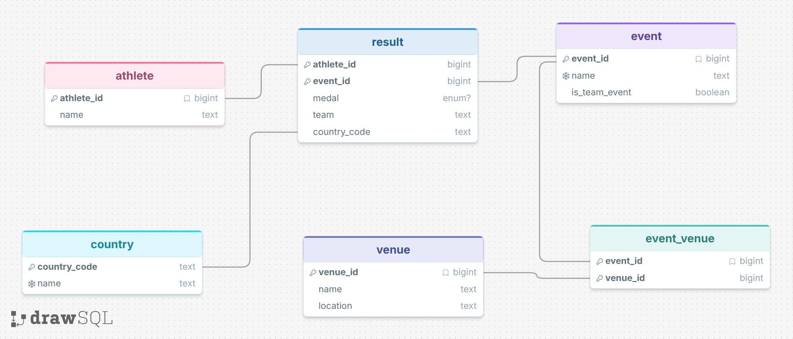

# Salt Lake 2002: AI + SQL

My app answers questions about athletes, countries, medals, and venues at the 2002 Winter Olympics. It uses TypeScript, SQLite, and OpenAI to turn a question into SQL, query the database, and explain the results.

[Code and database](https://github.com/aleczaitz/salt-lake-2002-ai-sql) · [Six additional examples](EXAMPLES.md)

**Worked:** “Which athletes won the most medals?”

[Generated SQL](first_ai_query.sql)

Answer: “Ole Einar Bjrndalen and Janica Kosteli tied for the most medals, with 4 each.” Names retain the source dataset's spelling.

**Failed before the fix:** “How many medals did Canada win in men's ice hockey?”

[Generated SQL](examples/failed-hockey.sql)

Answer: “Canada won 0 medals in men's ice hockey.” The correct answer is 1. The SQL searched for `Ice Hockey Men`, which wasn't the stored event name.

**Prompting:** I compared zero-shot (no examples) with single-domain few-shot (three examples from this database). Initially, zero-shot got 5/6 correct and few-shot got 4/6. After supplying actual event names and clearer matching instructions, both got 6/6. Examples alone didn't help in this run; exact names mattered. This was a small test, with one trial per question and style.

[Full comparison and saved responses](experiments/2026-10-14T17-24-56-933Z/review.md)
